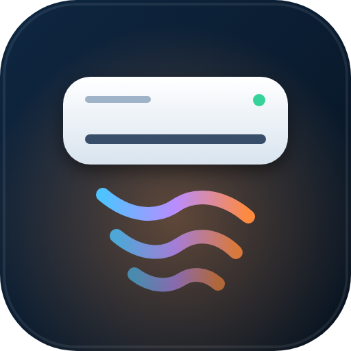

<p align="center"></p>

<h1 align="center">Qlima Control</h1>

<p align="center">
Lokal styring af Qlima- og Midea-varmepumper fra Home Assistant – uden sky.<br>
En ESP32-C3 til ca. 30 kr. erstatter WiFi-sticken i anlæggets USB-port, og integrationen gør resten.
</p>

<p align="center">
<a href="https://mrdonnii.github.io/qlima-control/"><b>Installér firmware i browseren</b></a> ·
<a href="#installation-i-home-assistant">Home Assistant</a> ·
<a href="#byg-esp32-donglen">Byg donglen</a> ·
<a href="#english">English</a>
</p>

---

## Hvad får du

**I anlægget (ESP32-firmwaren)**
- Fuld styring via anlæggets egen USB-port: tænd/sluk, varme, køl, auto, affugtning, blæser, Eco/Boost/Nat/Frostvagt 8 °C.
- **Follow Me** via en IR-diode: anlægget regulerer efter *din* rumføler i stedet for sin egen føler oppe under loftet.
- Auto-vip, lamel ét trin og display til/fra via IR – præcis som fjernbetjeningen.
- Udetemperatur fra udedelen, anlæggets egen føler, filtertimer og "anlæg svarer".
- **Lokalt web-UI** på `http://<ip>` til styring og status – virker også uden Home Assistant.
- WiFi-opsætning uden kode: ESP'en laver sit eget netværk første gang.
- **Opdaterer sig selv**: nye firmware-udgivelser her i repoet dukker op som en opdatering i Home Assistant.

**I Home Assistant (integrationen)**
- **Rumtermostat** med start/stop-hysterese, min. kørsel/pause og en neutral tomgang i stedet for at slukke og tænde kompressoren.
- **Flere rumfølere** – gennemsnit, vægtet i %, koldeste eller varmeste. Sendes automatisk til anlægget som Follow Me.
- **Døre og vinduer**: skru ned efter 5 min, sluk efter 20 min, genoptag efter 10 min lukket – med nedtællinger.
- **Shelly / effektmåler**: "Varmer"/"Køler", varmeeffekt, COP og alarm hvis anlægget kører uden effekt.
- **Strømkontakt** (fx Shelly-relæet der forsyner anlægget): tænd/sluk, **Genstart anlæg** (30 sek. uden strøm) og valgfri automatisk genstart, hvis anlægget holder op med at svare.
- **Elpris**: varmepris pr. kWh og pris pr. time.
- **COP** fra en fysisk model (Carnot med belastning), kalibreret mod Qlimas SCOP.
- **Frigiv-knap**, status ("Varmer", "Venter på start", "Dør åben"…) og "Næste skift".
- **Notifikationer** til telefonen: anlæg svarer ikke, rens filter, slukket pga. åben dør.
- Alt sættes op i Home Assistants brugerflade – og kan ændres bagefter.

> Testet med **Qlima S 5225 / SC 5225** og **S 5232 / SC 5232** (Midea-OEM med "Qlima WiFi-stick"). Andre Midea-anlæg med USB-dongleport virker sandsynligvis også – vælg "Andet Midea-anlæg".

---

## Byg ESP32-donglen

### Indkøbsliste (pr. anlæg)

| Del | Bemærkning |
|---|---|
| ESP32-C3 SuperMini (eller anden ESP32-C3) | ca. 20–30 kr. |
| USB-A han-stik / et gammelt USB-kabel | klip enden af – stikket skal i anlægget |
| Modstand 4,7 kΩ | pull-up til 5 V (vigtig – uden den svarer anlægget ikke) |
| IR-diode 940 nm, 5 mm | til Follow Me, vip og display. En diode fra en gammel fjernbetjening virker fint |
| Modstand 470 Ω (220–470 Ω) | i serie med IR-dioden |
| Krympeflex / lidt varmlim | |

### Ledningsføring

```
USB-A stik (til anlægget)          ESP32-C3
──────────────────────────         ──────────────────────────
Rød    5V   ─────────────┬──────── 5V
                         │
                       4,7 kΩ
                         │
Grøn   D+  (anlæg RX) ───┴──────── GPIO6   (TX, open-drain)
Hvid   D−  (anlæg TX) ──────────── GPIO7   (RX, intern pull-up)
Sort   GND ─────────────────────── GND

ESP32-C3 GPIO10 ── 470 Ω ── (+) langt ben  [IR-diode 940 nm]  kort ben (−) ── GND
```

- Farverne i USB-kabler passer ikke altid. Set forfra med plastikken nedad er benene i USB-A-stikket fra venstre: **5V, D−, D+, GND**. Mål efter med et multimeter.
- Anlæggets indgang kræver **5 V-niveau** – derfor kører ESP'ens TX som open-drain med 4,7 kΩ op til 5 V. Uden modstanden svarer anlægget ikke.
- Bytter du D− og D+, sker der intet slemt – anlægget svarer bare ikke. Byt dem så.
- **Sæt aldrig ESP'ens USB-C i en computer, mens den sidder i anlægget** (den får så 5 V fra to sider).

### IR-dioden

Anlægget tager kun imod Follow Me, vip og display via IR – ikke via USB-porten. Placér IR-dioden få millimeter fra anlæggets IR-modtager bag displayet (inde bag frontpanelet), rettet mod modtagerens kuppel og uden at dække vinduet, så fjernbetjeningen stadig virker. Fastgør med varmlim. **Sluk anlægget på strømmen før du åbner det** – hovedprintet har 230 V.

Test: tryk **Lamel ét trin** – anlægget bipper.

### Flash firmwaren

**Nemmest:** åbn **<https://mrdonnii.github.io/qlima-control/>** i Chrome eller Edge, sæt ESP32-C3'en i computeren og tryk *Installér*. Du kan vælge WiFi direkte i installeren.

**Med ESPHome:** ESPHome finder den som "Qlima Control" og tilbyder at adoptere den. Eller brug filen [`esphome/qlima-control-esp32c3.yaml`](esphome/qlima-control-esp32c3.yaml) i dit eget ESPHome.

### WiFi og web-UI

- Første opstart uden WiFi: forbind til netværket **Qlima Control** (kode `qlimacontrol`), vælg dit WiFi på siden der åbner (eller `http://192.168.4.1`).
- Web-UI: `http://<ip-adresse>` – bruger `admin`, kode `qlima`. Her kan du styre anlægget og se status uden Home Assistant.
- Navnet får automatisk ESP'ens MAC-adresse som endelse (fx `qlima-control-2c40c8`), så flere anlæg kan stå side om side.

### Opdateringer

Når der kommer en ny firmware her i repoet, viser Home Assistant **"Firmware – opdatering tilgængelig"** på ESP'en. Tryk installér – den henter og installerer selv over WiFi.

---

## Installation i Home Assistant

1. **HACS** → ⋮ → *Brugerdefinerede repositories* → `https://github.com/MRDonnii/qlima-control` → kategori *Integration*. Installér **Qlima Control** og genstart Home Assistant.
2. Sørg for at ESP'en er tilføjet i **ESPHome**-integrationen (den bliver normalt fundet automatisk).
3. **Indstillinger → Enheder og tjenester → Tilføj integration → Qlima Control**.
4. Vælg ESP'en i anlægget og kobl rummets sensorer på:

| Sektion | Felter |
|---|---|
| **Anlæg** | navn, ESP i anlægget, model (5225 / 5232 / andet Midea) |
| **Rumfølere** | rumtemperatur (én eller flere + gennemsnit/vægtet/koldeste/varmeste), fugtighed, udetemperatur, elpris |
| **Strøm og Shelly** | effektmåler, energimåler, strømkontakt (Shelly-relæ), automatisk genstart, "kører over" W, maks. effekt |
| **Døre og vinduer** | sensorer, skru ned efter, sluk efter, genoptag efter, skru ned til målet eller minimum |
| **Styring** | mål ved varme/køl, start- og stop-hysterese, min. kørsel/pause, manuel overstyring |
| **Notifikationer** | notify-tjeneste (fx `notify.mobile_app_telefon`), filter-påmindelse |
| **Avanceret** | termostater der skal pauses, følerfrister |

**Bagefter** kan alt justeres under *Indstillinger → Enheder og tjenester → Qlima Control → Konfigurer*: en menu hvor du vælger én af grupperne ovenfor (også ESP'en og modellen).

Vælger du **vægtet**, får du et trin hvor hver føler får en procent. En føler der er offline udelades, og de andre deler dens vægt.

### Enheder

| Enhed | |
|---|---|
| `climate` | rumtermostaten – brug denne på dine dashboards |
| Status, Næste skift (+ nedtællinger under Diagnostik) | hvad den gør nu, og hvornår den skifter |
| Rumtemperatur, Rumfugtighed, Udetemperatur, Anlæggets føler | |
| Elforbrug, Energi, COP, Varmeeffekt, Varmepris, Pris pr. time | kræver effektmåler/elpris |
| Varmer, Køler, Dør/vindue åben, Anlæg svarer, Kører uden effekt | binære sensorer |
| Frigiv, Sving til/fra, Lamel ét trin, Display, Nulstil filtertæller, Genstart anlæg (strøm) | knapper |
| Follow Me, Bip, Strøm til anlæg, Reagér på døre og vinduer | kontakter |
| Dør/vindue: skru ned efter, sluk efter, genoptag efter | tal (minutter) – ændres med det samme |
| Program | anlæggets Eco/Boost/Nat/Frostvagt |

### Sådan regulerer den

- Varmepumpen starter, når rummet er **under målet** (start-hysterese, standard 0,1 °C), og holder i tomgang når rummet er **målet + 0,5 °C** – anlæggets setpunkt sænkes til minimum i stedet for at slukke, så kompressoren skånes.
- Uden denne styring kører Midea-anlæg typisk videre til ca. 2 °C over målet.
- Ændrer nogen noget på fjernbetjeningen, respekteres det som **manuel overstyring** (standard 120 min). **Frigiv** afslutter den med det samme.
- Slukker man anlægget på fjernbetjeningen, slukker termostaten også.

### Begrænsninger

- Anlæggene tager kun **hele grader** (også Follow Me).
- Swing/vip styres via IR, så Home Assistant kan ikke se om anlægget vipper.
- Anlæggene svarer kun med Mideas korte status – ingen kompressorfrekvens eller effekt fra anlægget selv. Brug en effektmåler.

---

## Fejlfinding

| Problem | Løsning |
|---|---|
| ESP'en kommer ikke på WiFi | Mange C3 SuperMini har en svag antenne – firmwaren kører med 8,5 dBm. Flyt tættere på routeren. |
| "Anlæg svarer" er slukket | Mangler 4,7 kΩ pull-up, eller D−/D+ er byttet. |
| Follow Me/vip virker ikke | Kontrollér at IR-dioden blinker (telefonkamera) og sidder tæt på modtageren. Prøv 220 Ω. |
| Varmer for længe | Brug termostaten fra integrationen (ikke anlæggets egen `climate`). |
| Opsætningen siger "ingen klimaenhed" | ESP'en kører ikke Qlima Control-firmwaren, eller den er ikke tilføjet i ESPHome. |

---

## English

Qlima Control gives you **local control of Qlima/Midea split heat pumps** (Qlima S/SC 5225 and 5232 tested) from Home Assistant. An ESP32-C3 replaces the unit's WiFi stick in its USB port (Midea UART at 9600 baud, 5 V open-drain with a 4.7 kΩ pull-up), and an IR LED next to the unit's receiver handles Follow Me, swing and display. Flash it from the [web installer](https://mrdonnii.github.io/qlima-control/), add it in ESPHome, then add the **Qlima Control** integration (HACS custom repository) and link room temperature sensors (mean, weighted %, min or max), humidity, a power meter, electricity price, doors and windows and a notify service. You get a room thermostat with hysteresis, door/window staging, Follow Me, COP and heat price, filter reminders, release/status/countdowns and all unit functions as buttons. The firmware has a local web UI and updates itself from this repository's releases.

---

Lavet af MRDonnii · MIT-licens · ikke tilknyttet Qlima eller Midea.
